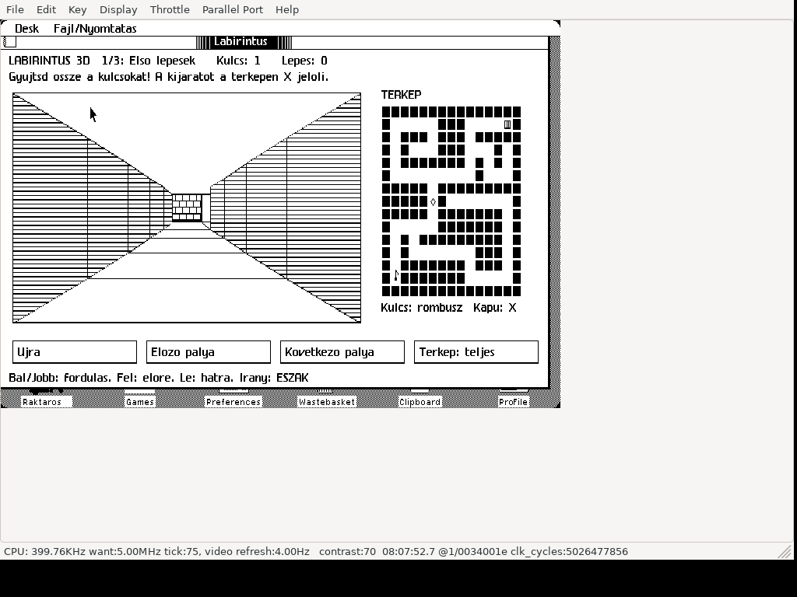

# Labirintus 3D — Maze game for Apple Lisa 2

**Native Motorola 68000 application for real Apple Lisa 2 hardware running
Lisa Office System 3 / 3.1**, intended for Lisa 2/5 and 2/10. LisaEm is also supported.

Three original 15×15 mazes, a first-person perspective corridor view and an
adjacent overhead map. Collect the keys, then reach the exit. Captions are
Hungarian without accents to suit the native Lisa font. Movement is grid based.

## Download and run

Download **[Labirintus3D.dc42](https://github.com/julyus7/lisa-labirintus/releases/latest/download/Labirintus3D.dc42)**
or [dist/Labirintus3D.dc42](dist/Labirintus3D.dc42) using Download raw.
This 419284-byte, tagged DC42 is a 400 KB application floppy. Boot your own LOS first.

### Real Apple Lisa 2

Write the complete image using a Lisa-compatible floppy writer that preserves
native sector tags, or a compatible floppy replacement. Open the floppy and
launch **Labirintus**. Copying the DC42 file onto an ordinary formatted floppy
does not write a Lisa disk image. For hard-disk installation use LOS Duplicate,
then move the duplicate into your destination folder and wait for copying to finish.

### LisaEm

Boot your LOS, mount the DC42 and launch **Labirintus**. Select
**Key → Raw Keyboard**. Reactivate a set-aside game window before playing.

## Controls

| Key | Action |
| --- | --- |
| Left / Right | Turn 90 degrees |
| Up | Move forward one cell |
| Down | Move backward without turning |

Hold one arrow to repeat; release it to stop. Multiple simultaneous arrows
do not issue a command. Buttons restart, choose the previous/next level and
toggle the full/explored map. The exit wins only after collecting every key.
A fresh launch starts the first level; progress is not saved across launches.

Own corridor/map icon, tool ID **249**, volume identity suffix **D60A**.
The release was tested alongside the existing tools and installed on a private
LOS hard disk; its executable matched the floppy after shutdown and readback.

## Source, build and validation

[Build instructions](BUILD.md) · [Hungarian instructions](README-HU.md) ·
[Validation](VALIDATION.md) · [Credits](CREDITS.md)

The release was compiled with Lisa Pascal 3.26, MC68000 Code Generator 3.16
and Lisa Linker 3.0, without errors. Recorded testing: **69359 independent model
checks and 345 native checks**, including completing all three levels, key
release, map modes and frame stability. Hard-disk installation, floppy eject,
hard-disk launch and a real turn input were also checked.

**Physical Lisa 2, Windows LisaEm and a separate LOS 3.0 runtime remain untested.**
Real Lisa hardware is the native target; emulator tests are not physical tests.
ROMs, OS/Workshop images, proprietary SDK libraries, private VM disks and
credentials are not included. The application floppy contains its linked runtime.
